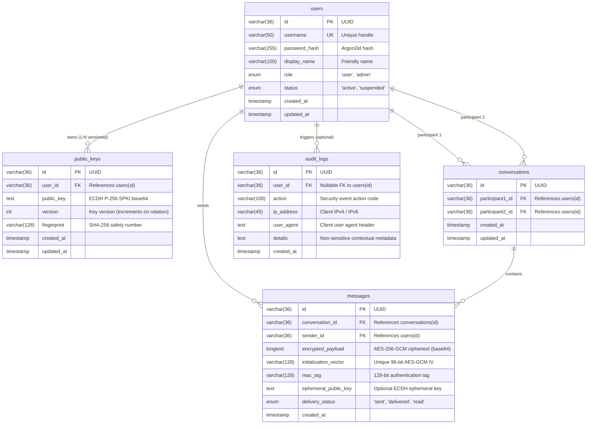

# SecureChat — Database Architecture & Cryptographic Schema Design

> **University Capstone Project: SecureChat**  
> **Group 7 Team:**
> - **SENG KOEMNAN** (Project Manager / Full-Stack Lead)
> - **REAM RITHY & SENG KOEMNAN** (Backend & AI Engineers)
> - **SOK SOVANRITH & SENG KOEMNAN** (Frontend Developers)
> - **HENG MINOU** (QA & DevOps Specialist)

---

## 1. Overview & Engine Specification

The SecureChat data layer runs on **MySQL 8.0** using the **InnoDB** storage engine with strict relational constraints, foreign keys, and indexes. All tables are created with `CHARACTER SET utf8mb4 COLLATE utf8mb4_unicode_ci` to support full Unicode emojis and international characters without truncation or security vulnerabilities.

### Core Security Principles of the Schema
1. **Zero-Plaintext Storage**: The database server acts strictly as a blind relay and encrypted storage engine. The `messages` table stores only ciphertext (`encrypted_payload`), initialization vectors (`initialization_vector`), and authentication tags (`mac_tag`).
2. **Zero-Private-Key Storage**: The database only stores client-generated public keys (`public_keys`). Private keys never leave the user's browser runtime.
3. **Argon2id Password Protection**: User passwords are saved only as salted Argon2id hashes ($m=65536, t=3, p=4$). Plaintext passwords or weak hashes (MD5/SHA1/plain SHA256) are strictly prohibited.
4. **Sanitized Audit Trail**: The `audit_logs` table logs security events (logins, registrations, key publications, admin actions) while strictly omitting credentials, private keys, or message bodies.

---

## 2. Entity-Relationship Diagram (ERD)



---

## 3. Data Dictionary & Table Definitions

### 3.1 Table: `users`
| Column | Type | Nullable | Default | Description |
|---|---|---|---|---|
| `id` | `VARCHAR(36)` | NO | PRIMARY KEY | UUID v4 unique user identifier. |
| `username` | `VARCHAR(50)` | NO | UNIQUE | Unique alphanumeric username (lowercase). |
| `password_hash` | `VARCHAR(255)` | NO | - | Argon2id salted hash string. |
| `display_name` | `VARCHAR(100)` | YES | NULL | Optional user display name. |
| `role` | `ENUM('user', 'admin')` | NO | `'user'` | Role for Role-Based Access Control (RBAC). |
| `status` | `ENUM('active', 'suspended')` | NO | `'active'` | Account state toggleable by administrators. |
| `created_at` | `TIMESTAMP` | NO | `CURRENT_TIMESTAMP` | Account creation timestamp. |
| `updated_at` | `TIMESTAMP` | NO | `CURRENT_TIMESTAMP ON UPDATE` | Last modification timestamp. |

### 3.2 Table: `public_keys`
| Column | Type | Nullable | Default | Description |
|---|---|---|---|---|
| `id` | `VARCHAR(36)` | NO | PRIMARY KEY | UUID v4 key record identifier. |
| `user_id` | `VARCHAR(36)` | NO | FK | Owner user ID (CASCADE on delete). |
| `public_key` | `TEXT` | NO | - | Base64-encoded ECDH P-256 SPKI public key. |
| `version` | `INT` | NO | `1` | Incrementing key version (triggers change warnings). |
| `fingerprint` | `VARCHAR(128)` | NO | - | SHA-256 hex/formatted safety number string. |
| `created_at` | `TIMESTAMP` | NO | `CURRENT_TIMESTAMP` | Key registration timestamp. |
| `updated_at` | `TIMESTAMP` | NO | `CURRENT_TIMESTAMP ON UPDATE` | Last update timestamp. |

### 3.3 Table: `conversations`
| Column | Type | Nullable | Default | Description |
|---|---|---|---|---|
| `id` | `VARCHAR(36)` | NO | PRIMARY KEY | UUID v4 conversation identifier. |
| `participant1_id` | `VARCHAR(36)` | NO | FK | First participant user ID. |
| `participant2_id` | `VARCHAR(36)` | NO | FK | Second participant user ID. |
| `created_at` | `TIMESTAMP` | NO | `CURRENT_TIMESTAMP` | Thread creation timestamp. |
| `updated_at` | `TIMESTAMP` | NO | `CURRENT_TIMESTAMP ON UPDATE` | Thread update timestamp. |

*Unique Constraint*: `UNIQUE KEY unique_participants (participant1_id, participant2_id)` guarantees at most one direct conversation thread between two users.

### 3.4 Table: `messages`
| Column | Type | Nullable | Default | Description |
|---|---|---|---|---|
| `id` | `VARCHAR(36)` | NO | PRIMARY KEY | UUID v4 message identifier. |
| `conversation_id` | `VARCHAR(36)` | NO | FK | Parent conversation ID. |
| `sender_id` | `VARCHAR(36)` | NO | FK | Sender user ID. |
| `encrypted_payload` | `LONGTEXT` | NO | - | Base64-encoded AES-256-GCM ciphertext. |
| `initialization_vector` | `VARCHAR(128)` | NO | - | Hex/Base64 96-bit AES-GCM IV (nonce). |
| `mac_tag` | `VARCHAR(128)` | NO | - | Hex/Base64 128-bit authentication tag. |
| `ephemeral_public_key`| `TEXT` | YES | NULL | Optional ECDH ephemeral public key. |
| `delivery_status` | `ENUM('sent', 'delivered', 'read')` | NO | `'sent'` | Real-time delivery receipt state. |
| `created_at` | `TIMESTAMP` | NO | `CURRENT_TIMESTAMP` | Dispatch timestamp. |

### 3.5 Table: `audit_logs`
| Column | Type | Nullable | Default | Description |
|---|---|---|---|---|
| `id` | `VARCHAR(36)` | NO | PRIMARY KEY | UUID v4 log record identifier. |
| `user_id` | `VARCHAR(36)` | YES | NULL | Initiating user ID (SET NULL on delete). |
| `action` | `VARCHAR(100)` | NO | - | Event type (e.g. `USER_LOGIN_SUCCESS`, `KEY_ROTATION`). |
| `ip_address` | `VARCHAR(45)` | YES | NULL | IPv4 or IPv6 client network address. |
| `user_agent` | `TEXT` | YES | NULL | Client browser / device user agent. |
| `details` | `TEXT` | YES | NULL | Sanitized JSON metadata (no secrets). |
| `created_at` | `TIMESTAMP` | NO | `CURRENT_TIMESTAMP` | Event timestamp. |

---

## 4. Execution & Verification

### Running Migrations:
```bash
# In backend directory:
npm run db:migrate
```

### Seeding Test Data:
```bash
# In backend directory:
npm run db:seed
```

### Default Seed Accounts:
| Username | Password | Role | E2EE Key Version |
|---|---|---|---|
| `alice` | `Password123!` | user (Project Lead) | v1 |
| `bob` | `Password123!` | user | v2 (Rotated) |
| `charlie` | `Password123!` | user | v1 |
| `admin` | `AdminPass123!` | admin | v1 |
